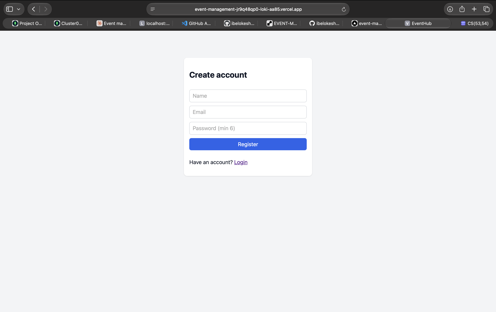
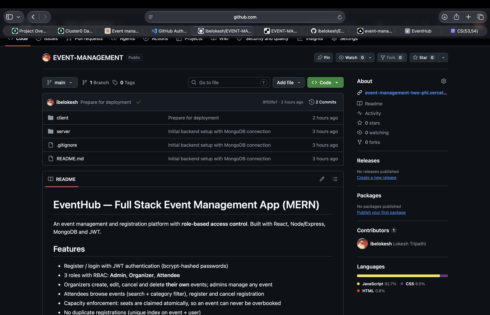

# EventHub — Full Stack Event Management App (MERN)


---
---

## 🚀 AWS Live Deployment

**Live Website:**  AWS PROJECT
http://ServiceHub-ALB-180870333.ap-south-1.elb.amazonaws.com

**GitHub Repository:**  
https://github.com/shivani958/Service-hub

**Hosting:** AWS EC2 + Application Load Balancer  
**Database:** MongoDB Atlas## 🚀 AWS Live Deployment


**Hosting:** AWS EC2 + Application Load Balancer  
**

An event management and registration platform with **role-based access control**. Built with React, Node/Express, MongoDB and JWT.

## Features
- Register / login with JWT authentication (bcrypt-hashed passwords)
- 3 roles with RBAC: **Admin**, **Organizer**, **Attendee**
- Organizers create, edit, cancel and delete **their own** events; admins manage any event
- Attendees browse events (search + category filter), register and cancel registration
- Capacity enforcement: seats are claimed atomically, so an event can never be overbooked
- No duplicate registrations (unique index on event + user)
- Organizers/admins view the attendee list for an event
- "My registrations" view, dashboard stats, responsive UI
- Admins manage users (change roles, delete)

## Role permissions
| Action | Admin | Organizer | Attendee |
|---|:-:|:-:|:-:|
| Browse events | Yes | Yes | Yes |
| Register / cancel own registration | Yes | Yes | Yes |
| Create events | Yes | Yes | No |
| Edit / delete / change status of events | Any event | Own events only | No |
| View attendee list | Any event | Own events only | No |
| View user list | Yes | Yes | No |
| Change roles / delete users | Yes | No | No |

## Tech stack
React 18 + Vite, React Router, Axios · Node.js + Express · MongoDB + Mongoose · JWT + bcryptjs

## Data model
- **User** — name, email (unique), password (hashed), role
- **Event** — title, description, category, venue, date, capacity, registeredCount, price, status (upcoming/completed/cancelled), createdBy → User
- **Registration** — event → Event, user → User (unique pair)

## REST API
| Method | Endpoint | Access |
|---|---|---|
| POST | /api/auth/register | Public |
| POST | /api/auth/login | Public |
| GET | /api/auth/me | Authenticated |
| GET | /api/events?search=&category=&status= | Authenticated |
| GET | /api/events/mine/registered | Authenticated |
| POST | /api/events | Admin, Organizer |
| PUT | /api/events/:id | Admin, Organizer (own events) |
| DELETE | /api/events/:id | Admin, Organizer (own events) |
| POST | /api/events/:id/register | Authenticated |
| DELETE | /api/events/:id/register | Authenticated (own registration) |
| GET | /api/events/:id/attendees | Admin, Organizer (own events) |
| GET | /api/users | Admin, Organizer |
| PATCH | /api/users/:id/role | Admin |
| DELETE | /api/users/:id | Admin |

## Run locally
```bash
# Backend
cd server
cp .env.example .env      # edit MONGO_URI and JWT_SECRET
npm install
npm run seed              # creates demo users + sample events
npm run dev

# Frontend (new terminal)
cd client
cp .env.example .env
npm install
npm run dev               # http://localhost:5173
```


Demo accounts created by the seed (change these before deploying):

| Role | Email | Password |
|---|---|---|
| Admin | admin@eventhub.com | admin123 |
| Organizer | organizer@eventhub.com | organizer123 |
| Attendee | attendee@eventhub.com | attendee123 |

## Deployment
1. **Database:** create a free cluster on MongoDB Atlas, allow network access, copy the connection string.
2. **Backend (Render or AWS EC2/Elastic Beanstalk):** root `server`, build `npm install`, start `npm start`.
   Env vars: `MONGO_URI`, `JWT_SECRET`, `CLIENT_URL` (your frontend URL), `JWT_EXPIRES_IN`.
3. **Frontend (Vercel/Netlify/S3):** root `client`, build `npm run build`, output `dist`.
   Env var: `VITE_API_URL=https://<your-backend>/api`.
4. Redeploy the backend after setting `CLIENT_URL` so CORS allows your frontend.

## Project structure
```
server/  config, controllers, middleware, models, routes, server.js, seed.js
client/  src/{components, context, pages, services}
```

## Live demo
https://event-management-two-phi.vercel.app

